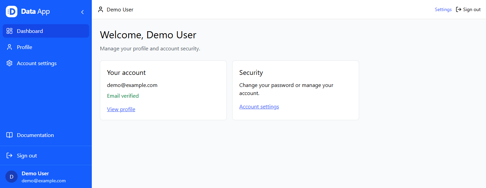
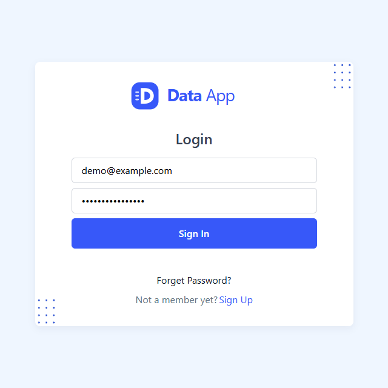
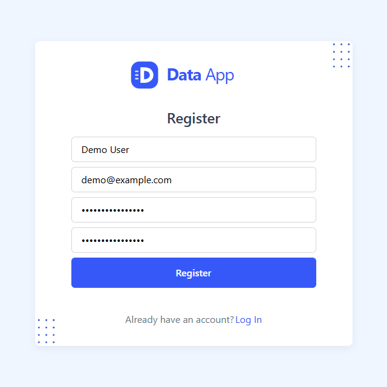
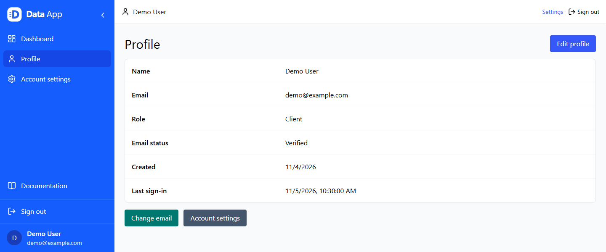
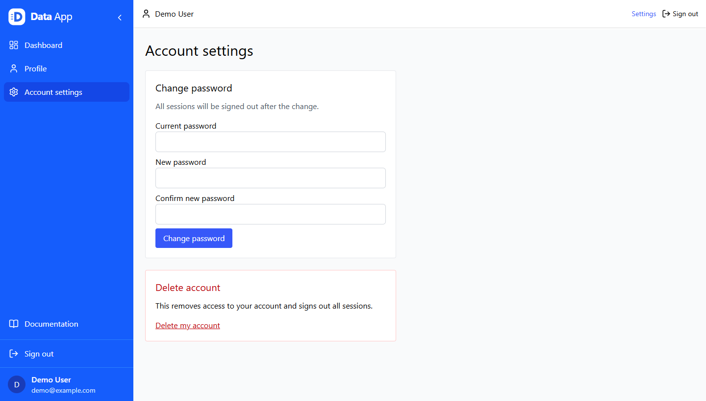
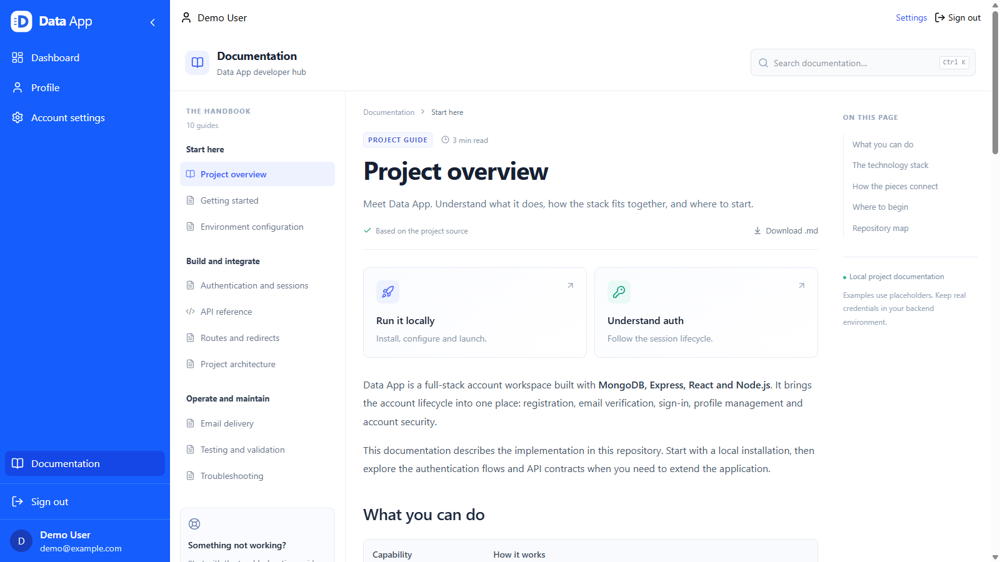

<p align="center">
  
</p>

<h1 align="center">Data App</h1>

<p align="center">
  <strong>A complete account workspace built with the MERN stack.</strong><br />
  Verified sign-up, cookie-based sessions, account security, and an integrated developer handbook.
</p>

<p align="center">
  <a href="#features">Features</a> &middot;
  <a href="#screenshots">Screenshots</a> &middot;
  <a href="#quick-start">Quick start</a> &middot;
  <a href="#configuration">Configuration</a> &middot;
  <a href="#documentation">Documentation</a>
</p>

[](docs/images/dashboard.png)

<p align="center"><sub>The workspace at a glance: account status, profile access, security settings, and project documentation.</sub></p>

## Overview

Data App is a React and Express application that covers the account lifecycle: create an account, verify an email, sign in, recover access, update a profile, and manage account security.

The frontend and backend are separate projects. MongoDB stores users, revocable sessions, and email jobs. A built-in SMTP worker delivers account notifications, while the private Documentation page explains the implementation with searchable Markdown guides and copyable code examples.

## Features

| Area | What is included |
| --- | --- |
| **Registration and verification** | Six-digit email codes, expiry, attempt limits, and code resend. |
| **Authentication** | HttpOnly JWT cookies, persisted sessions, refresh-token rotation, and server-side revocation. |
| **Account management** | Display-name updates, confirmed email changes, password recovery, and password changes. |
| **Account deletion** | Current-password confirmation, anonymization, secret removal, and session revocation. |
| **Developer documentation** | Ten guides, full-content search, keyboard shortcuts, a page outline, syntax highlighting, copy, and Markdown download. |
| **Responsive workspace** | A collapsible, animated sidebar, mobile overlay navigation, and reduced-motion support. |
| **Validation and access** | Strict server schemas, role permissions, request limits, origin checks, and controlled error responses. |
| **Delivery and testing** | Persisted SMTP retries, isolated backend integration tests, and frontend behavior tests. |

## Screenshots

The previews use the same screens as the application. Authentication images share a compact square frame; workspace screenshots retain enough navigation to show where each feature belongs. Click an image to open it at full resolution.

### Sign in, create an account, recover access

<table>
  <thead>
    <tr>
      <th width="33%">Sign in</th>
      <th width="33%">Registration</th>
      <th width="33%">Password recovery</th>
    </tr>
  </thead>
  <tbody>
    <tr>
      <td><a href="docs/images/sign-in.png"></a></td>
      <td><a href="docs/images/sign-up.png"></a></td>
      <td><a href="docs/images/password-recovery.png"></a></td>
    </tr>
    <tr>
      <td>Access an existing verified account.</td>
      <td>Create an account and continue to email verification.</td>
      <td>Request a time-limited password-reset link.</td>
    </tr>
  </tbody>
</table>

### A clear profile and deliberate account actions

[](docs/images/profile.png)

The profile exposes account details and verified status. Editing a name, requesting an email change, and opening security settings are separate actions.

<details>
  <summary><strong>View account security settings</strong></summary>
  <br />
  <a href="docs/images/account-settings.png"></a>
  <p>Password changes sign out existing sessions. Account deletion requires the current password and an explicit confirmation.</p>
</details>

> Screenshots use a presentation-only profile, **Demo User / demo@example.com**. There is no bundled demo login or seeded administrator account.

## Documentation

[](docs/images/documentation.png)

After signing in, open **Documentation** above **Sign out**, or visit `/documentation`.

The handbook contains ten guides covering setup, environment variables, authentication, API contracts, routes, architecture, email delivery, testing, and troubleshooting. It includes:

- Full-content search, including configuration variable names, with `Ctrl+K` or `Cmd+K`.
- Section links and an active page outline on wide screens.
- Highlighted code blocks with copy controls.
- Previous/next guide navigation and downloadable `.md` files.
- A mobile guide selector and internally scrollable reference tables.

The same content is available in the repository:

| Start here | Build and integrate | Operate and maintain |
| --- | --- | --- |
| [Project overview](frontend/src/pages/documentation/content/overview.md) | [Authentication and sessions](frontend/src/pages/documentation/content/authentication.md) | [Email delivery](frontend/src/pages/documentation/content/email-delivery.md) |
| [Getting started](frontend/src/pages/documentation/content/getting-started.md) | [API reference](frontend/src/pages/documentation/content/api-reference.md) | [Testing and validation](frontend/src/pages/documentation/content/testing.md) |
| [Environment configuration](frontend/src/pages/documentation/content/configuration.md) | [Routes and redirects](frontend/src/pages/documentation/content/routing.md) | [Troubleshooting](frontend/src/pages/documentation/content/troubleshooting.md) |
| | [Project architecture](frontend/src/pages/documentation/content/architecture.md) | |

Edit the Markdown files in `frontend/src/pages/documentation/content/`. Their titles, order, and groups are registered in [guides.js](frontend/src/pages/documentation/guides.js).

## Technology stack

| Layer | Main packages |
| --- | --- |
| Frontend | React 19, React Router 7, Vite 8, Tailwind CSS 4 |
| Forms and requests | Formik, Yup, Axios, React Toastify |
| Backend | Express 5, Mongoose 9, Zod, AccessControl |
| Authentication | bcryptjs, jsonwebtoken, cookie-parser |
| Email | Nodemailer with SMTP and a persisted job queue |
| Documentation | React Markdown, remark-gfm, Rehype, Highlight.js |
| Tests | Node test runner, Supertest, mongodb-memory-server, Vitest, Testing Library, jsdom |

## Quick start

### Requirements

- A supported Node.js version: **22.22.2+ on Node 22**, **24.15+ on Node 24**, or **26+**.
- npm, a MongoDB database, and SMTP credentials for a development inbox.
- Available local ports **3000** and **7500**.

There is no root install command: install dependencies in both package directories.

### 1. Install and configure the backend

From the repository root:

```powershell
cd backend
npm ci

# Keep an existing local configuration intact.
if (-not (Test-Path .env)) {
  Copy-Item .env.example .env
}
```

Fill in `backend/.env` using the configuration reference below. Then start the API:

```powershell
npm run dev
```

The backend uses Node's built-in watch mode and waits for MongoDB before it starts listening.

### 2. Start the frontend

In a second terminal, from the repository root:

```powershell
cd frontend
npm ci
npm run dev
```

Open **http://localhost:3000**. The development server uses a strict port; if it is already occupied, stop the old process or deliberately change the port and `CLIENT_URL` together.

### 3. Check readiness and register

```powershell
Invoke-RestMethod http://localhost:7500/api/health
```

A connected API responds with HTTP `200` and `{ "success": true }`.

Register a development account, open its verification message in **Mailtrap Sandbox**, and enter the six-digit code. Verification creates the session and opens the dashboard. Sandbox emails are captured in the test inbox rather than delivered to the recipient's real mailbox.

## Configuration

Actual credentials belong in **`backend/.env`**, which Git ignores. Versioned examples and documentation contain placeholders only.

```dotenv
# backend/.env
NODE_ENV=development
PORT=7500
CLIENT_URL=http://localhost:3000
MONGO_URI=mongodb://127.0.0.1:27017/advanced_mern_auth

JWT_SECRET=replace-with-a-unique-random-secret-at-least-32-characters
JWT_REFRESH_SECRET=replace-with-another-unique-random-secret-at-least-32-characters
ACCESS_TOKEN_SECONDS=900
REFRESH_TOKEN_SECONDS=604800

SMTP_HOST=sandbox.smtp.mailtrap.io
SMTP_PORT=2525
SMTP_USER=your-sandbox-smtp-username
SMTP_PASS=your-sandbox-smtp-password
EMAIL_FROM="Data App Dev <from@example.com>"
```

Generate a fresh secret locally, then run the command again for the refresh secret. The two values must differ:

```powershell
node -e "console.log(require('node:crypto').randomBytes(48).toString('hex'))"
```

The frontend only needs the public API URL:

```dotenv
# frontend/.env or frontend/.env.local
VITE_APP_API_URL=http://localhost:7500/api
```

| Setting | Behavior |
| --- | --- |
| `CLIENT_URL` | Frontend origin for CORS, request-origin checks, and links in emails. |
| `MONGO_URI` | Local MongoDB or an Atlas connection string. |
| `JWT_SECRET` / `JWT_REFRESH_SECRET` | Different secrets, each at least 32 characters. |
| `ACCESS_TOKEN_SECONDS` | Access JWT and cookie lifetime; 900 seconds by default. |
| `REFRESH_TOKEN_SECONDS` | Absolute session lifetime; 604800 seconds by default. |
| `SMTP_*` | SMTP host, port, username, and password. |
| `EMAIL_FROM` | Configurable sender display name and address. |
| `NODE_ENV` | Enables Secure cookies when set to `production`. |

Keep MongoDB, SMTP, and JWT secrets out of all `VITE_*` variables: Vite exposes those values to the browser. Restart the appropriate server after changing its environment file.

**Using Atlas:** create a database user, select the intended database, and add the connecting network's current public IP to the project's IP Access List. Moving between home, a cafe, a VPN, and mobile data can change that IP. Keep TLS enabled. See the [configuration guide](frontend/src/pages/documentation/content/configuration.md) for URI formats, origins, and DNS troubleshooting.

## How authentication works

```text
Registration
  -> account created, verification email queued
  -> six-digit code + matching email
  -> account verified, session persisted, HttpOnly cookies set
  -> private workspace

Protected API request
  -> validate access JWT, active account, session, and version
  -> if needed: coordinate refresh, rotate the token, retry once
  -> revoked or expired session: return to sign in
```

- Verification codes last **10 minutes**, allow **five incorrect attempts**, and are stored as keyed hashes.
- Refresh credentials are hashed in MongoDB and rotated atomically. The default **seven-day** session has an absolute expiry.
- Logout revokes the current session. Password reset/change, confirmed email change, and account deletion revoke all sessions for that account.
- Email change and deletion require the current password. Confirmation links are single-use and expire after **one hour**.
- Recovery requests use a neutral public response. New passwords require at least **8 characters** and at most **72 UTF-8 bytes**.
- The API validates inputs independently of the frontend, filters inactive accounts, and returns an allowlisted public user DTO.

Roles are declared for Client, Employer, and Admin. Public registration creates a Client; a complete job API or admin dashboard is not included.

## Project structure

```text
advanced_MERN_Auth/
├── backend/
│   ├── config/           Environment validation, SMTP, roles
│   ├── controllers/      HTTP response adapters
│   ├── middleware/       Authentication, schemas, permissions, limits
│   ├── models/           User, Session, EmailJob
│   ├── repositories/     Shared user queries
│   ├── routes/           API routes
│   ├── services/         Account operations
│   ├── test/             Isolated integration tests
│   └── utils/            Tokens, cookies, email templates, worker
├── frontend/src/
│   ├── api/              HTTP client and auth helpers
│   ├── components/       Shared UI and navigation
│   ├── context/          Authentication state and actions
│   ├── layouts/          Auth and workspace layouts
│   ├── pages/            Screens and Markdown documentation
│   ├── test/             Frontend behavior tests
│   └── utils/            Route definitions and guards
└── docs/images/          Versioned README screenshots
```

## Development commands

| Location | Command | Purpose |
| --- | --- | --- |
| `backend/` | `npm run dev` | Start the API with source watching. |
| `backend/` | `npm start` | Start without source watching. |
| `backend/` | `npm test` | Run integration tests with temporary MongoDB and simulated SMTP. |
| `frontend/` | `npm run dev` | Start the Vite development server. |
| `frontend/` | `npm test` | Run UI, auth-state, refresh, and documentation tests. |
| `frontend/` | `npm run lint` | Check React and JavaScript rules. |
| `frontend/` | `npm run build` | Build the frontend into `dist/`. |
| `frontend/` | `npm run preview` | Preview a frontend build locally. |
| Either package | `npm audit` | Check known dependency advisories. |

Frontend preview does not start the API. If it uses a different origin, update `CLIENT_URL` and restart the backend before testing authenticated requests.

Backend tests use `mongodb-memory-server` and test-only secrets; they do not use the local Atlas configuration or send real SMTP messages. The first run downloads a MongoDB binary. Frontend tests use Vitest, Testing Library, and jsdom.

## Implementation notes

<details>
  <summary><strong>Email delivery, local operation, and deployment boundaries</strong></summary>

- The SMTP worker runs inside the backend process, checks persisted jobs every five seconds, and retries failures up to five times. Old jobs expire after one day; recipient and HTML content are removed after successful submission.
- SMTP delivery is separate from a completed account operation. Queue persistence and account changes do not share a database transaction, so an ambiguous database failure still requires checking the actual account state before retrying.
- Delivery is at least once: a process stopping after SMTP acceptance but before saving the result can cause a duplicate notification.
- Cookies use HttpOnly, SameSite strict, and path `/`. Production adds Secure; use HTTPS and keep frontend and API on the same site.
- Request limits use process memory. Multiple production instances require a shared limiter store and an intentional trusted-proxy configuration.
- `/auth/check-email` is a deliberately public availability endpoint; it can reveal whether an address is in use.
- OAuth, passkeys, two-factor authentication, deployment automation, external monitoring, and automatic account restoration are not implemented.
- Keep both lockfiles. ESLint 9 is retained for compatibility with the React plugin; reviewed Lodash overrides update Formik's pinned transitive dependencies.

</details>

For source-level details, open the [API reference](frontend/src/pages/documentation/content/api-reference.md), [routing guide](frontend/src/pages/documentation/content/routing.md), or [troubleshooting guide](frontend/src/pages/documentation/content/troubleshooting.md).

[Upgrade notes](UPGRADE_NOTES.md) record the implementation changes. The [initial review](security_best_practices_report.md) is historical and describes the state before those fixes.
